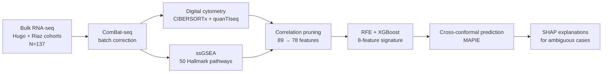

## Hi there 👋
# Hi, I'm Zoi 👋

**Contracting Lead in Clinical Trials · Physicist by training · Medical Engineering & Informatics (MSc)**

I work where **clinical research, contracts and data** meet. By day I negotiate agreements with the vendors we collaborate with on clinical trials and make sure they follow the required guidelines. In my own time I build computational tools that ask the same question from the science side: *how do we make better, safer decisions for patients?*

🗣️ English · Spanish · a little German
📍 Thessaloniki, Greece
📫 Reach me: `<ZoiLiami LinkedIn / zoliami@hotmail.com>`

---

## 🔬 Featured project: Uncertainty-aware immunotherapy response prediction

> **MSc thesis**, Medical Engineering & Informatics, School of Medicine, Aristotle University of Thessaloniki (2026). Supervisor: Prof. Antigoni Malousi.

Immune checkpoint inhibitors (anti-PD-1) have transformed metastatic melanoma treatment, but only a minority of patients respond durably, and non-responders still face serious immune-related toxicity. Existing biomarkers such as Tumor Mutational Burden (TMB) say little about the immune microenvironment, and standard ML classifiers force a yes/no answer even when they are unsure.

This project builds a **multi-omic, uncertainty-aware pipeline** that predicts binary response (Responder vs. Non-Responder) from **bulk RNA-seq**, and tells the clinician *when not to trust the prediction*.

### Pipeline

### Key results

| Question | Finding |
|---|---|
| Can a 3-class model separate CR / PR+SD / PD? | No. About 50–57% accuracy; intermediate states overlap, so the task was reframed as a binary **"rule-out"** model |
| 8-feature XGBoost (immune + metabolic signature) | **82.1% test accuracy**, **92% recall for Non-Responders** (test set, n=28) |
| Raw-gene baselines (LASSO / Ridge, 6,431 genes) | ~50% CV accuracy, i.e. overfit and near random |
| Standalone TMB (matched cohort, n=55) | 58.2% accuracy, ROC-AUC 0.648 |
| 8-feature signature on the same n=55 cohort | Balanced random forest: 83.6% accuracy, ROC-AUC 0.917 |
| Conformal prediction | 97.9% single-class (decisive) predictions at 80% confidence; at 95% confidence the model flags 57.6% of samples as **ambiguous** and routes them for human review |

**The 8 selected features:** M1 macrophages, monocytes, NK cells, naive B cells, plasma cells, plus the Apical Surface, Heme Metabolism and PI3K-AKT-mTOR pathways.

**Why conformal prediction?** It turns a single point prediction into a prediction *set* with a user-chosen error rate. Easy cases are automated; borderline patients are flagged, and **SHAP** waterfall/force plots show which biological signals are in conflict (for example strong plasma-cell signal vs. low M1 macrophages).

### Tech stack

`Python` · `R` · `XGBoost` · `scikit-learn` · `imbalanced-learn (SMOTE)` · `MAPIE` · `SHAP` · `GSVA / ssGSEA` · `sva (ComBat-seq)` · `CIBERSORTx` · `quanTIseq / quantiseqr` · `GEOquery`

### Data

Public GEO cohorts: **GSE78220** (Hugo et al., n=28) and **GSE91061** (Riaz et al., n=109). TMB / WES data were retrieved from the TIGER resource.

### Honest limitations

- Small, retrospective public cohorts; independent external validation is still needed.
- Headline numbers come from small test/CV sets (n=28 and n=55), so confidence intervals are wide.
- Merging Partial Response and Stable Disease into "Responder" smooths over clinically relevant gradations.
- Bulk deconvolution cannot resolve spatial structure or single-cell heterogeneity.
- This is a research prototype, **not a clinical tool**.

### Where this could go

Validation in other immunogenic tumours (e.g. NSCLC), fusion with pathology-image features, and spatial / single-cell transcriptomics.

📄 **Repo:** `<link to your thesis repository>` · **Full thesis:** `<link or DOI>`

---

## 🌊 Second project: OceanScanner (start-up business plan)

> **BEBS Master's thesis**, academic year 2022/23, written as a team of four.

A full business plan for a SaaS start-up, "the **Skyscanner of ocean freight**": a platform that aggregates quotes, bookings, tracking and bill-of-lading documents from multiple shipping carriers in one place, with shipment environmental-impact metrics and a blockchain-based document layer.

- **Market:** top-down TAM → SAM → SOM of roughly 280,000 → 56,000 → 2,800 target clients over a 5-year horizon
- **Scope:** market research (PEST, primary survey, secondary data), competitive analysis, marketing and branding plan, operations and tech plan, HR, and a financial plan with break-even and scenario analysis
- **My role:** supply-chain expert and "client champion", drawing on front-office experience resolving client problems in freight forwarding

---

## 🧭 What connects the two

Both projects are about **turning messy, high-stakes information into a defensible decision**, whether that is a patient's treatment pathway, a clinical-trial vendor agreement, or a business case. My physics background taught me to ask what the data can and cannot support, and that habit shows in the uncertainty-aware approach above.

## 🛠️ Skills

**Clinical operations & contracting:** vendor negotiation · clinical-trial agreements · guideline & compliance alignment
**Data science:** Python · R · scikit-learn · XGBoost · explainable AI · conformal prediction
**Bioinformatics:** RNA-seq · batch correction · immune deconvolution · pathway enrichment · biomarker benchmarking
**Business:** market sizing · competitive analysis · financial modelling

---

*Open to conversations about clinical-trial operations, computational immuno-oncology, or the places where they overlap.*
<!--
**ZoiLiami/ZoiLiami** is a ✨ _special_ ✨ repository because its `README.md` (this file) appears on your GitHub profile.

Here are some ideas to get you started:

- 🔭 I’m currently working on ...
- 🌱 I’m currently learning ...
- 👯 I’m looking to collaborate on ...
- 🤔 I’m looking for help with ...
- 💬 Ask me about ...
- 📫 How to reach me: ...
- 😄 Pronouns: ...
- ⚡ Fun fact: ...
-->
